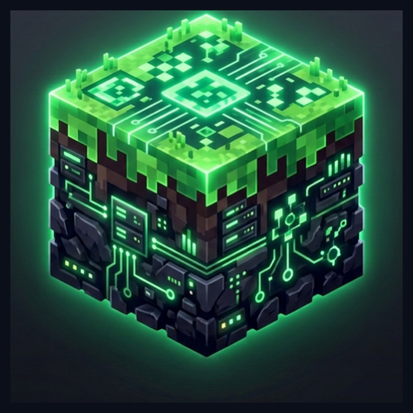
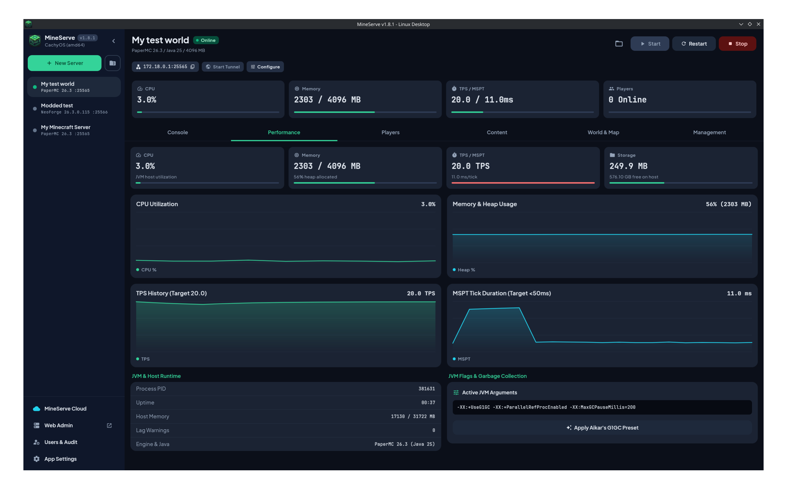
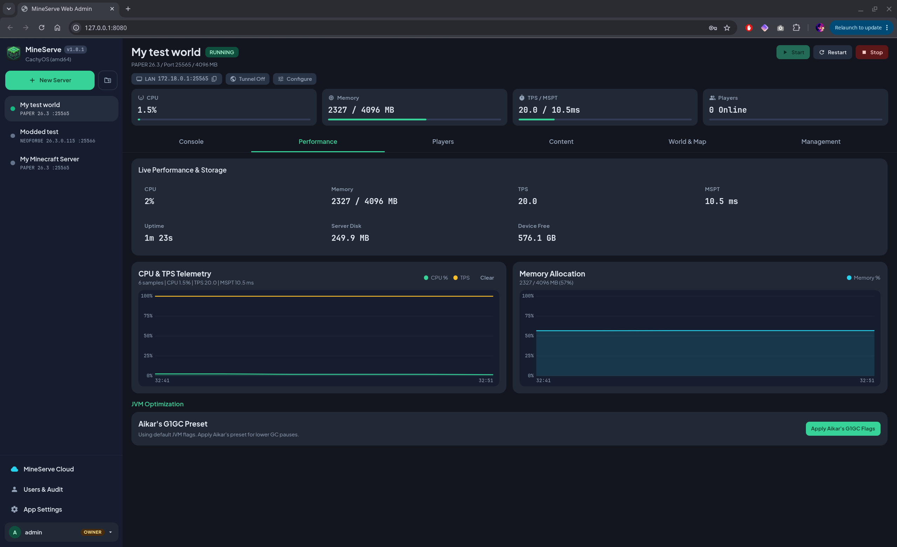
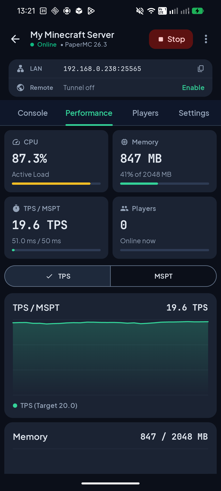
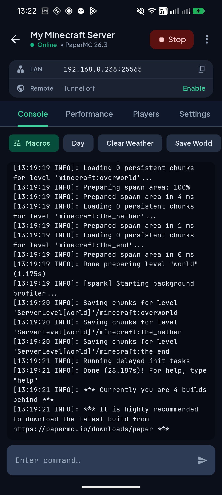
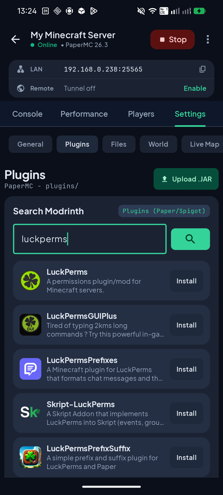
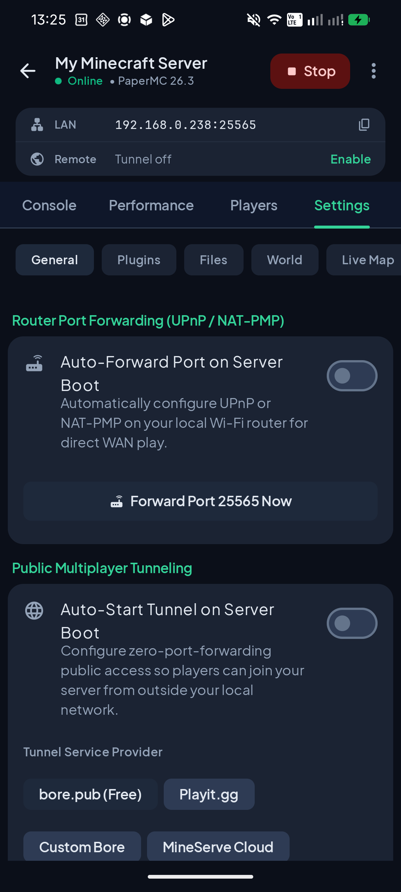
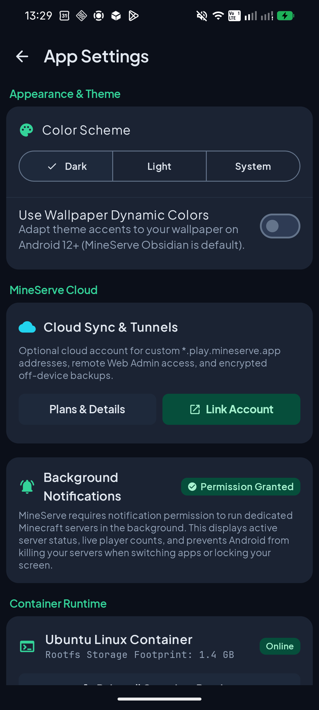

<div align="center">



# MineServe

**Open-Source Minecraft Server Manager for Android, Linux, macOS, Windows & Docker**

[](LICENSE)
[-38BDF8.svg?style=for-the-badge&logo=android&logoColor=white)](#android)
[](#linux-desktop--headless)
[](#macos--windows-beta)
[](#docker)

[](https://play.google.com/store/apps/details?id=com.devwithzachary.mineserve)
[](https://f-droid.org/packages/com.devwithzachary.mineserve/)
[](https://apps.obtainium.imranr.dev/redirect?r=obtainium://add/https://github.com/devwithzachary/MineServe)
[](https://github.com/devwithzachary/MineServe/releases/latest)
[](https://mineserve.app)
[](https://discord.gg/QdT9yCrKmV)

</div>

---

## What is MineServe?

**MineServe** is a free, GPL-3.0 open-source Minecraft server manager that lets you download, configure, run, and manage dedicated **Java Edition, Bedrock, Modded, and Proxy servers** natively across **Android (100% rootless)**, **Linux**, **macOS (Beta)**, **Windows (Beta)**, and **Docker**.

- **11 Server & Proxy Engines**: Paper, Purpur, Folia, Fabric, NeoForge, Forge, Mojang Vanilla, Bedrock Cross-Play (Paper + GeyserMC), Bedrock Dedicated Server, Velocity, and BungeeCord.
- **Zero-Config Java & Modpacks**: Automatic isolated Adoptium OpenJDK (8, 17, 21, 25) provisioning, Modrinth browser, and `.mrpack` importer with automatic client-only mod filtering.
- **Multiplayer Networking & Automation**: Built-in UPnP/NAT-PMP, `bore.pub`, `Playit.gg`, optional MineServe Cloud vanity tunnels, Cron scheduled backups/restarts, Idle Sleep + Auto-Wake on Ping, Discord webhooks, and WebDAV/Nextcloud sync.
- **Unified GUI & Web Remote Admin**: Native Material Design 3 ("Obsidian & Ore") interface with a 6-tab server workspace, live ANSI/SSE console, crash quick-fixes, Squaremap live map, and multi-user RBAC Web Admin on port `8080`.

> Looking for full feature walkthroughs, CLI flags, RBAC permissions, or source build instructions? Read the **[Complete User Guide](USER_GUIDE.md)**.

### How MineServe Compares

| Tool | Platforms | Setup | License & Ads | Built-In Tunnels |
| :--- | :--- | :--- | :--- | :--- |
| **MineServe** | Android (rootless), Linux, Win, macOS, Docker | 1-line script, APK, or Docker | GPL-3.0, zero ads | Bore, Playit.gg, UPnP, optional Cloud |
| **Crafty Controller** | Linux, Win, macOS, Docker | Docker or Python install | GPL-3.0, zero ads | Manual port forward / DIY |
| **Pterodactyl / Pelican** | Linux + Docker | Nginx, MariaDB, Redis, Wings | MIT, zero ads | Manual / VPS public IP |
| **Aternos** | Web browser (cloud) | Browser signup | Closed, web ad-funded | Built-in (with queues & RAM caps) |

---

## Screenshots

### Desktop Studio & Headless WebUI (:8080)

<p align="center">
  
  
</p>

### Android (100% Rootless)

<p align="center">
  
  
  
  
</p>
<p align="center">
  
  
  
  
</p>

---

## Quick Start & Installation

### Android

- Install from [Google Play](https://play.google.com/store/apps/details?id=com.devwithzachary.mineserve) or download `MineServe-<version>-release.apk` from [GitHub Releases](https://github.com/devwithzachary/MineServe/releases/latest) (Android 8.0+, `arm64-v8a` or `x86_64`, zero root required).
- Launch MineServe to complete first-run PRoot + OpenJDK 21 setup, tap **+ Create Server**, and press **Start**.

### Linux (Desktop & Headless)

Run the 1-line installer (auto-detects `.deb`, `.pkg.tar.zst`, or portable `.tar.gz`):

```bash
# Desktop GUI + CLI
curl -fsSL https://mineserve.app/install.sh | bash

# Headless systemd service (Web Admin on port 8080)
curl -fsSL https://mineserve.app/install.sh | bash -s -- --headless
```

Or download `.deb`, `.rpm`, `.AppImage`, `.pkg.tar.zst`, or `.tar.gz` directly from [GitHub Releases](https://github.com/devwithzachary/MineServe/releases/latest), or use our GPG-signed `apt` / `dnf` repositories documented in [USER_GUIDE.md](USER_GUIDE.md#linux-desktop-gui--headless).

### Docker

```bash
docker run -d --name mineserve \
  -p 8080:8080 -p 8081:8081 -p 25565:25565/tcp -p 25565:25565/udp -p 19132:19132/udp \
  -v mineserve-data:/data \
  ghcr.io/devwithzachary/mineserve:latest
```

Retrieve the generated `admin` password from `docker logs mineserve` and open `http://localhost:8080`.

### macOS & Windows (Beta)

- **macOS (Apple Silicon & Intel):** Download `MineServe-<version>-macos-arm64.dmg` or `MineServe-<version>-macos-x64.dmg` from [GitHub Releases](https://github.com/devwithzachary/MineServe/releases). (During Beta before Apple notarization in `v2.0.0`, allow via **System Settings -> Privacy & Security** or `xattr -dr com.apple.quarantine /Applications/MineServe.app`.)
- **Windows (`x64`):** Download `MineServe-<version>-windows-x64.msi`, `.exe`, or portable `.zip` from [GitHub Releases](https://github.com/devwithzachary/MineServe/releases).

See [USER_GUIDE.md](USER_GUIDE.md) for headless CLI flags (`mineserve --headless`), firewall setup, WebDAV/Cloud sync, Proxy networks, and building from source.

---

## Documentation & Community

- **[User Guide](USER_GUIDE.md)**: Complete platform setup, 6-tab workspace reference, CLI flags, diagnostics, and source build guide.
- **[Roadmap](ROADMAP.md)**: Planned features for `v1.9.0` and `v2.0.0`.
- **[Changelog](CHANGELOG.md)**: Full technical release history.
- **[Website](https://mineserve.app)** & **[Discord Community](https://discord.gg/QdT9yCrKmV)**.
- **License**: [GNU General Public License v3.0 (GPL-3.0)](LICENSE).

> **Disclaimer**: MineServe is an independent open-source project and is not affiliated with, approved by, or associated with Mojang Synergies AB or Microsoft Corporation.
