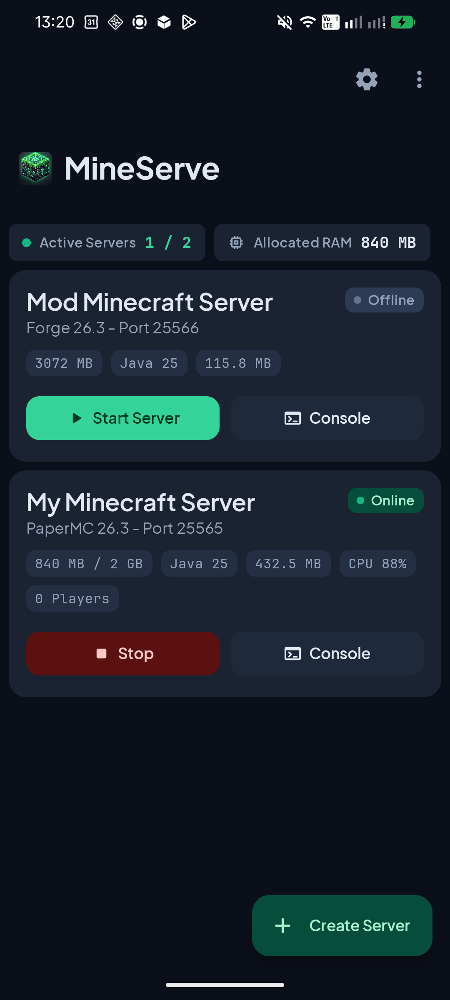
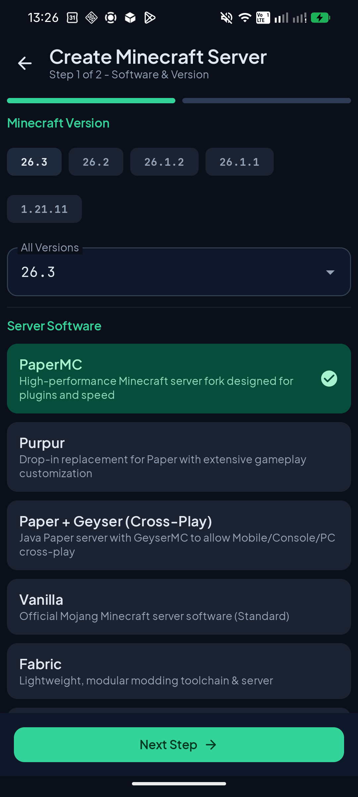
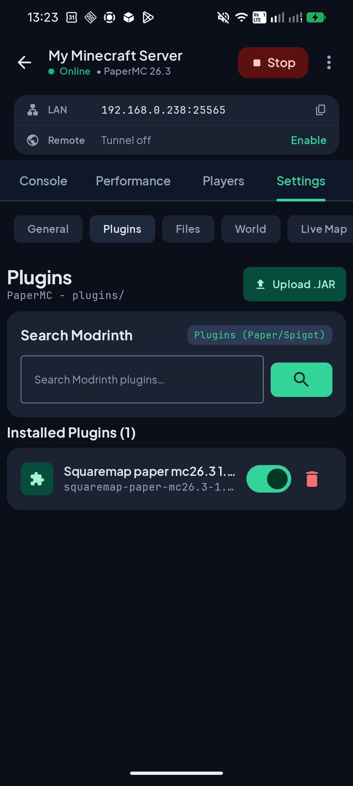
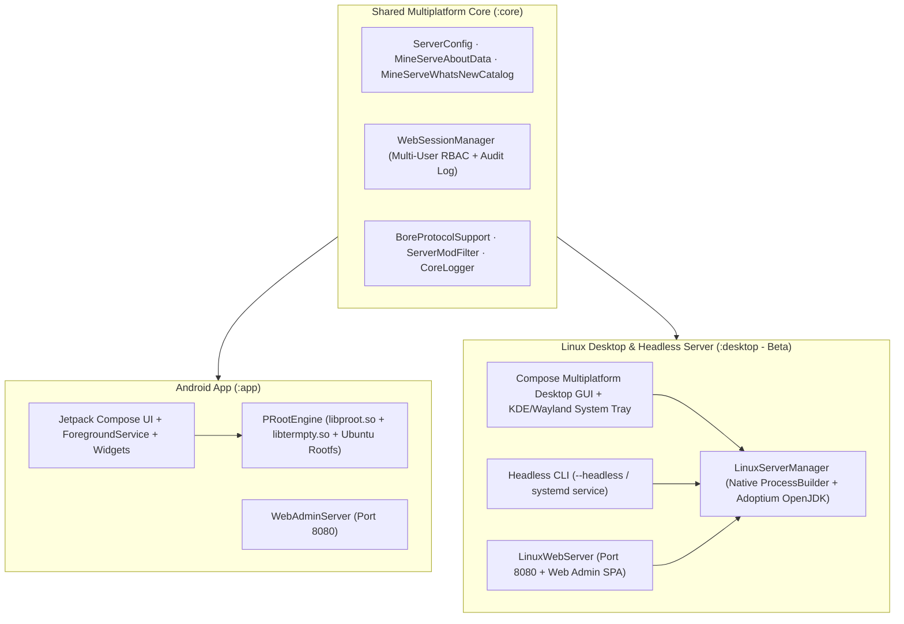

<div align="center">


# MineServe

**Dedicated Minecraft Server Hosting for Android & Linux (Desktop GUI & Headless Server Beta)**

[](LICENSE)
[-38BDF8.svg?style=for-the-badge&logo=android&logoColor=white)](#-mineserve-for-android-100-rootless)
[-FCC624.svg?style=for-the-badge&logo=linux&logoColor=black)](#-mineserve-for-linux-desktop-gui--headless-server---beta)
[](#architecture-overview)
[](https://kotlinlang.org)
[](https://www.jetbrains.com/lp/compose-multiplatform/)

[](https://play.google.com/store/apps/details?id=com.devwithzachary.mineserve)
[](https://f-droid.org/packages/com.devwithzachary.mineserve/)
[](https://github.com/devwithzachary/MineServe/releases/latest)
[](https://mineserve.app)

</div>

---

## Overview

**MineServe** is a free and open-source Minecraft server manager that lets you download, configure, run, and manage full-featured dedicated **Minecraft Java Edition, Bedrock, and Proxy servers** natively on **Android devices** (100% rootless) and **Linux PCs, home servers, and VPS instances** (Beta).

- **On Android**: Powered by a native **PRoot virtualization engine** (`libproot.so`), a JNI-backed PTY pseudo-terminal, and isolated Ubuntu rootfs environments so your phone or tablet never requires root permissions.
- **On Linux (Desktop GUI & Headless Server Beta)**: Runs server processes directly via native OS `ProcessBuilder` with zero container overhead, automatically downloads isolated Adoptium Temurin OpenJDK runtimes (Java 8, 17, 21, and 25), and provides both a native **Compose Multiplatform Desktop GUI** (with KDE/Wayland & X11 system tray integration and HiDPI scaling) and a **Headless CLI / `systemd` Web Admin mode** (`--headless`).

---

## 📱 Screenshots

<p align="center">
  
  
  
  
</p>
<p align="center">
  
  
  
  
</p>

---

## 🤖 MineServe for Android (100% Rootless)

MineServe turns any modern Android phone or tablet into a dedicated, portable Minecraft server with zero root permissions required.

### 📲 Download & Install on Android

- **Google Play Store**: [Download MineServe on Google Play](https://play.google.com/store/apps/details?id=com.devwithzachary.mineserve)
- **GitHub Releases (Direct APK)**: Download the signed `MineServe-<version>-release.apk` from [GitHub Releases](https://github.com/devwithzachary/MineServe/releases/latest)
- **F-Droid**: Coming soon (currently pending F-Droid review & approval)

**System Requirements**:
- **OS**: Android 8.0+ (API 26+) on `arm64-v8a` or `x86_64`
- **RAM**: 4 GB+ device RAM recommended for Vanilla / Paper servers; 6 GB to 8 GB+ recommended for modded Fabric, NeoForge, or Forge modpacks
- **Storage**: ~1.5 GB free internal storage for the isolated Ubuntu container, OpenJDK runtime, and server worlds

### 🚀 Getting Started on Android

1. **First-Run Container & Java Runtime Setup**:
   - Open **MineServe** on your Android device. On first launch, MineServe automatically downloads and extracts a minimal rootless Ubuntu environment inside PRoot and provisions **OpenJDK 21 LTS** (or lets you import a local rootfs `.tar.gz` archive for offline setup).
   - Grant the **Notification** permission (so the foreground service can display live TPS/player counts and Quick Actions) and set Battery Usage to **Unrestricted** when prompted so Android's background killer never interrupts an active world.
2. **Create or Import a Server**:
   - Tap the **+ Create Server** button on the dashboard to open the 4-step Server Creation Wizard.
   - Choose from **11 supported server & proxy engines** (Paper, Purpur, Folia, Fabric, NeoForge, Forge, Vanilla, Bedrock Cross-Play, Bedrock Dedicated, Velocity, or BungeeCord), or import an **existing server `.zip`** or **Modrinth `.mrpack` modpack**.
   - Select your Minecraft version, pick an isolated Java runtime (`Java 8`, `17`, `21`, or `25`), adjust the device-aware RAM allocation slider, accept the Minecraft EULA, and tap **Create & Install**.
3. **Start Your Server & Connect Friends**:
   - Tap **Start** on your server card. Monitor the live ANSI console in the **Console** tab or rolling CPU/RAM/TPS graphs in the **Performance** tab.
   - **Same Wi-Fi (LAN)**: Friends on your local network can connect immediately using the LAN IP and port shown at the top of the server screen.
   - **Over the Internet (WAN / 4G / 5G)**: Open the **Settings** tab on your server to enable automatic **UPnP / NAT-PMP** router port forwarding, start a zero-config **bore.pub** or **Playit.gg** public tunnel, or link **MineServe Cloud** for a custom `*.play.mineserve.app` address.
4. **Manage from Any Computer Browser (Optional)**:
   - Open **Web Remote Admin** from the dashboard header and toggle the server on (`port 8080`).
   - Open `http://<your-phone-ip>:8080` on any desktop or laptop browser to manage your console, files, plugins/mods, players, backups, and team RBAC accounts from a full keyboard and mouse.

---

## 🐧 MineServe for Linux (Desktop GUI & Headless Server - Beta)

MineServe `v1.8.0` introduces the **BETA Linux Desktop & Headless Server** edition (`:desktop`), bringing the full MineServe experience to Linux workstations, home servers, mini-PCs, and headless VPS instances.

### ⚡ 1-Line Quick Install

The universal Linux installer automatically detects your CPU architecture (`x86_64` / `arm64`) and Linux distribution, installing the native `.deb` package on Debian/Ubuntu/Mint, the native `.pkg.tar.zst` package on Arch/CachyOS/Manjaro, or the self-contained bundle with an embedded JRE on Fedora/RHEL/openSUSE and other distributions:

```bash
# Desktop GUI + CLI (installs native package or /opt/mineserve + desktop launcher)
curl -fsSL https://mineserve.app/install.sh | bash

# Headless Server (installs MineServe AND enables/starts the systemd service on port 8080)
curl -fsSL https://mineserve.app/install.sh | bash -s -- --headless

# Rootless User Install (installs into ~/.local/opt/mineserve without sudo)
curl -fsSL https://mineserve.app/install.sh | bash -s -- --user
```

### 📦 Linux Packages & Containers

Every GitHub Release includes pre-built packages for all major Linux distributions:

| Format | Target Systems | Install Command |
| :--- | :--- | :--- |
| **Debian / Ubuntu (`.deb`)** | Ubuntu, Debian, Linux Mint, Pop!_OS (`amd64`) | `sudo apt install ./mineserve_1.8.1_amd64.deb` |
| **Arch / CachyOS (`.pkg.tar.zst`)** | Arch Linux, CachyOS, Manjaro, EndeavourOS | `sudo pacman -U mineserve-1.8.1-1-x86_64.pkg.tar.zst` |
| **AppImage (`.AppImage`)** | Universal single-file portable Desktop GUI | `chmod +x MineServe-1.8.1-x86_64.AppImage && ./MineServe-1.8.1-x86_64.AppImage` |
| **Self-Contained `.tar.gz`** | Any `x86_64` Linux distro (includes bundled Java runtime) | `tar -xzf MineServe-1.8.1-linux-x64.tar.gz && cd MineServe-1.8.1-linux-x64 && sudo ./install.sh` |
| **Portable `.tar.gz` (No JRE)** | Any Linux system with Java 21+ (`x86_64` or `arm64`) | `tar -xzf MineServe-1.8.1-linux-portable-nojre.tar.gz` |
| **Docker / Docker Compose** | Headless Container (`amd64` & `arm64`) | `docker compose up -d --build` |

### 🚀 Getting Started on Linux

1. **Desktop GUI Mode**:
   - Launch **MineServe** from your desktop application menu or run `mineserve` in a terminal.
   - Click **+ Create** in the left sidebar to launch the 4-step Server Creation Wizard, pick an engine (Paper, Purpur, Fabric, Forge, NeoForge, Vanilla, Bedrock, Velocity, or BungeeCord), or import an existing server `.zip` or Modrinth `.mrpack` modpack.
   - MineServe automatically downloads and isolates the required Adoptium Temurin OpenJDK runtime (`Java 8`, `17`, `21`, or `25`) inside `~/.local/share/mineserve/runtimes/` and runs your server natively.
   - Close the window while a server is running to minimize MineServe to your system tray (left-click the tray icon to restore the window; right-click for quick actions). Adjust HiDPI UI scaling (`100%` to `175%`) anytime in **App Settings**.
2. **Headless Server Mode (`--headless`)**:
   - Start the headless daemon directly with `mineserve --headless` (or via `sudo systemctl enable --now mineserve`).
   - On first run, MineServe prints your auto-generated `admin` password to the terminal (or `journalctl -u mineserve -n 30`) and starts the Web Remote Admin panel on `http://<your-ip>:8080`.
   - You can generate a new admin password at any time from the terminal:
     ```bash
     mineserve --reset-admin
     ```
   - All server worlds, downloaded OpenJDK runtimes, backups, and settings are stored cleanly in `~/.local/share/mineserve` (configurable via `--data-dir <path>`).

### 🛠️ Linux CLI Flags

```text
Usage: mineserve [options]

Options:
  --headless                 Run without the Desktop GUI (Web Remote Admin + CLI daemon mode)
  --verbose, -v              Stream live Minecraft server console output directly to stdout
  --port <port>              Set the Web Remote Admin HTTP port (default: 8080)
  --bind <address>           Set the Web Remote Admin bind address (default: 0.0.0.0)
  --data-dir <path>          Set the MineServe data directory (default: ~/.local/share/mineserve)
  --reset-admin [password]   Reset the OWNER 'admin' account password (generates one if omitted)
  --reset-password <user>    Reset the password for a specific Web Admin username
  --print-service            Output a ready-to-use systemd unit file for this system
  --help, -h                 Show CLI usage instructions
```

---

## ✨ Key Features

### 🔒 100% Rootless Android Sandbox & Native Linux Engine
- **Zero Root Required on Android**: Executes entirely in Android user-space using native PRoot system call translation, `link2symlink`, and `fake_id0` extensions.
- **Zero-Overhead Native Linux Execution**: On Linux Desktop and Headless servers, server instances execute directly via `ProcessBuilder` with automatic firewall status checks (`ufw`, `firewalld`, `nftables`, `iptables`).
- **Multi-Version Isolated Java Environments**: Automatically provisions and manages isolated OpenJDK runtimes (**Java 8, 17, 21, and 25**) so legacy 1.12.2 Forge worlds, 1.16.5 servers, and the latest 1.21+ releases coexist cleanly.
- **Resumable Downloads & Offline File Imports**: Every runtime and server installer supports HTTP `Range` resumption, automatic retry with exponential backoff, and offline local `.jar` / `.tar.gz` imports.

### 🎮 11 Supported Server & Proxy Engines
| Engine | Category | Supported Versions | Highlights |
| :--- | :--- | :--- | :--- |
| **PaperMC** | Plugins (Bukkit/Spigot/Paper) | `1.8.8` - `1.21+` | High-performance async chunk loading & rich plugin ecosystem |
| **PurpurMC** | Plugins (Paper Fork) | `1.14.1` - `1.21+` | Drop-in Paper replacement with extensive gameplay customization |
| **Folia** | Regionized Multithreading | `1.19.4` - `1.21+` | PaperMC's multithreaded server engine for high player counts |
| **FabricMC** | Modular Modding | `1.14` - `1.21+` | Lightweight, fast-updating modding toolchain |
| **NeoForge** | Modern Modpacks | `1.20.2` - `1.21+` | Next-generation community modding platform |
| **Minecraft Forge** | Classic & Modern Modpacks | `1.1` - `1.21+` | Full automated `--installServer` support for classic and modern Forge |
| **Mojang Vanilla** | Official Java Edition | `1.0` - `1.21+` | Unmodified official Java server jars from Mojang's version manifest |
| **Bedrock Cross-Play** | Java + Bedrock (Geyser) | `1.20+` | Pre-configured Paper + Geyser-Spigot + Floodgate for UDP `19132` cross-play |
| **Bedrock Dedicated (Beta)** | Official Mojang C++ Bedrock | Latest | Native on `x86_64`; transparent `qemu-x86_64-static` translation on `arm64-v8a` |
| **Velocity Proxy** | Multi-Server Network Proxy | `3.x` | High-performance modern proxy by PaperMC with interactive backend linking |
| **BungeeCord Proxy** | Classic Network Proxy | Latest | Classic SpigotMC proxy for linking Lobby, Survival, and Creative backends |

### 🖥️ Multi-User Web Remote Admin, RBAC & Live SSE Console
- **Multi-User Accounts & 4-Tier Role-Based Access Control (RBAC)**: Create team accounts across **Owner**, **Admin**, **Moderator**, and **Viewer** roles with per-endpoint permission enforcement, active session revocation, and mandatory first-login password changes.
- **Searchable Audit Log & CSV Export**: Tracks logins, power actions, console commands, file edits, backups, and account changes with actor, role, IP address, and one-click CSV export.
- **Real-Time SSE Console & Telemetry Stream**: Low-latency Server-Sent Events (`/api/servers/{id}/stream`) push live ANSI-colored console output (2,000-line scrollback + 1-click Copy Console Output) and CPU/RAM/TPS metrics without polling lag.
- **Full Browser File Manager**: Create files and folders, rename, delete, edit configs, download files, upload multiple files with drag-and-drop, and extract `.zip` archives directly in the browser.
- **1-Click Engine Version & Build Upgrader**: Check if a newer Paper, Purpur, Folia, Fabric, NeoForge, Forge, Vanilla, or Velocity build is available and upgrade in place with an automatic pre-upgrade backup option.

### 🌐 Zero-Config Multiplayer Networking & Optional MineServe Cloud
- **Automatic UPnP & NAT-PMP Port Forwarding**: Pure-Kotlin SSDP/SOAP UPnP IGD and RFC 6886 NAT-PMP discovery automatically maps TCP/UDP ports on compatible home routers.
- **Built-In Public Tunnels (`bore.pub` & `Playit.gg`)**: Expose servers to friends over 4G/5G and CGNAT without router port forwarding. Includes native standalone `playit-linux` (`v0.15.26`) and pure-Kotlin `BoreProtocolSupport` on Linux and Android.
- **MineServe Cloud (Optional Paid Add-On)**:
  - **100% Optional**: All local hosting, Web Admin, UPnP/Bore/Playit tunnels, and WebDAV/SAF backups are free forever.
  - **In-App 6-Digit Email Code Sign-In**: Link your device on Android, Linux Desktop, or headless Web Admin using a passwordless 6-digit email verification code (or browser OAuth).
  - **Custom Vanities & Encrypted Cloud Backups**: Reserve memorable `*.play.mineserve.app` (and Pro `*.playms.uk`) addresses, `*.panel.mineserve.app` remote Web Admin relays, and automated Cloudflare R2 cloud backups.

### 🧩 Modrinth Marketplace & Smart `.mrpack` Client-Mod Filtering
- **In-App Modrinth Browser**: Search, filter, Install, Update, or Uninstall plugins and mods directly from Modrinth across Android, Linux Desktop, and Web Admin.
- **Smart `.mrpack` Modpack Import & Client-Only Mod Filtering**: Import full Modrinth `.mrpack` modpacks or existing server `.zip` archives. MineServe inspects Fabric (`fabric.mod.json`), Quilt (`quilt.mod.json`), Forge/NeoForge (`mods.toml` / `mcmod.info`), and class entrypoints to automatically disable client-only mods (such as Sodium, Iris, Zoomify, or Capes) as `.jar.disabled` so your dedicated server never crashes on startup.

### 🌍 World Management, In-App Live Map & Off-Device Backups
- **World Import, Export & Dimension Reset**: Import `.zip` or `.mcworld` worlds, export active saves, or reset the Nether (`DIM-1`) and End (`DIM1`).
- **Chunk Pre-Generator, Region Inspector & Pruner**: Pre-generate spawn chunks, inspect `.mca` Anvil regions by coordinate and size, and prune uninhabited chunks (`InhabitedTime`).
- **Interactive 2D Live Map Viewer**: Configure Squaremap and pan/zoom across live 2D rendered world tiles (or inspect your `.mca` region coordinate grid) directly inside the Android app, Linux Desktop GUI, and Web Admin panel.
- **Local & Cloud Backups**: Create 1-tap `.zip` backups with retention limits and automatic off-device sync to **Nextcloud / WebDAV**, **Android SAF folders** (Google Drive, SD cards), or optional **MineServe Cloud R2**.

### 💤 Smart Automation, Diagnostics & Safeguards
- **Smart Idle Auto-Shutdown & Sleep-on-Idle (Wake-on-Connection)**: Automatically stops idle servers and listens on the game port (Java TCP Handshake `0x00` / Ping `0xFE` and Bedrock RakNet UDP `0x01`/`0x02`) to display a waking MOTD and cold-boot the server when a player connects.
- **Cron Task Scheduler & Discord Webhooks**: Schedule automated backups, restarts, and commands, and push rich embeds to Discord.
- **In-App Diagnostics & 1-Click Support Bundle**: Run a 5-point network self-test, inspect live error logs with automatic token/secret redaction, and export a sanitized `.zip` diagnostic bundle from **App Settings -> Diagnostics & Logs**.

---

## 🏗️ Architecture Overview



---

## 🛠️ Building from Source

### Prerequisites
- **JDK 17 or 21** (OpenJDK 21 recommended)
- **Android SDK** (API 35) & **Android NDK** (`27.2.12479018`) for building the Android app (`:app`)
- **Linux (`x86_64`)** with `dpkg-deb`, `tar`, `curl`, and optional `makepkg` / `rpmbuild` for packaging Linux distributions

### 1. Build & Run the Linux Desktop GUI or Headless Server (`:desktop`)

```bash
# Launch the Linux Desktop GUI directly from source
./gradlew :desktop:run

# Run in Headless Server mode from source
./gradlew :desktop:run --args="--headless --verbose"

# Build all Linux distribution packages (.deb, .pkg.tar.zst, .AppImage, .tar.gz) into release/
./scripts/build_linux_packages.sh
```

### 2. Build the Android APK (`:app`)

```bash
# 1. Cross-compile native C/JNI binaries (libproot.so, libtalloc.so, libbore.so, libtermpty.so)
./scripts/build_native_libs.sh

# 2. Download offline bootstrap assets (Ubuntu 24.04 rootfs tarballs + Geyser/Floodgate jars)
./scripts/fetch_rootfs.sh

# 3. Compile and install the Debug APK onto a connected Android device
./gradlew installDebug
```

---

## 🗺️ Roadmap & Upcoming Features

See [ROADMAP.md](ROADMAP.md) for the complete release roadmap, including planned `v1.9.0` distributions (Arch Linux AUR `mineserve-bin`, official `ghcr.io` / Docker Hub multi-arch images, and signed APT/RPM repositories) and `v2.0` Windows & macOS Desktop support.

---

## 🤝 Contributing & Community

- **Website**: [https://mineserve.app](https://mineserve.app)
- **Discord Community**: [Join our Discord Server](https://discord.gg/QdT9yCrKmV)
- **Changelog**: [CHANGELOG.md](CHANGELOG.md)
- **License**: Licensed under the [GNU General Public License v3.0 (GPL-3.0)](LICENSE).

> **Disclaimer**: MineServe is an independent open-source project and is not affiliated with, approved by, or associated with Mojang Synergies AB or Microsoft Corporation.
