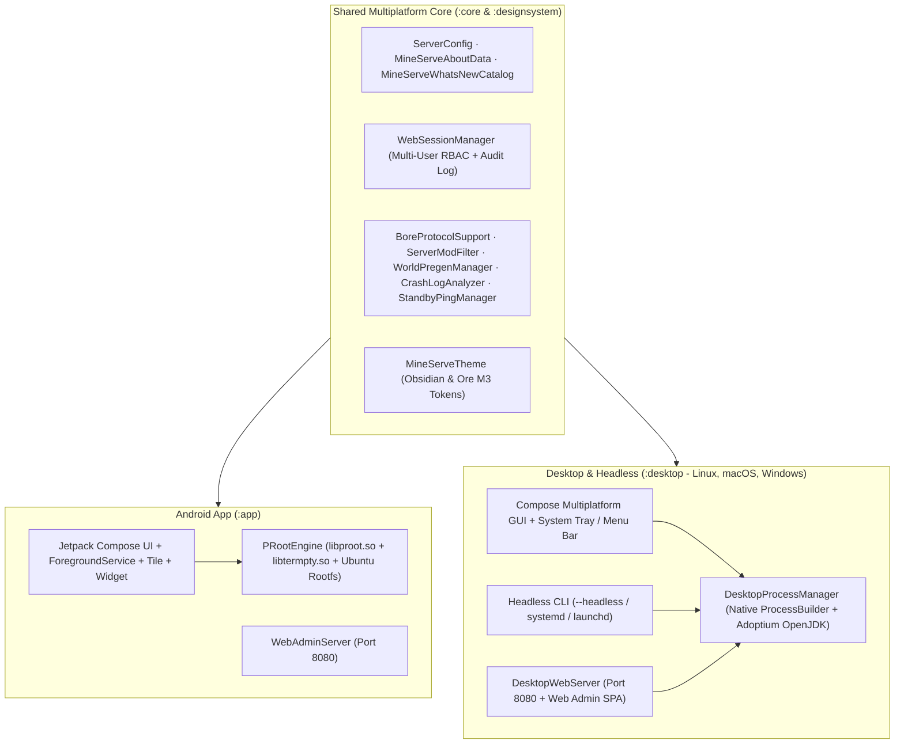

# MineServe User Guide

Welcome to the complete **MineServe User Guide**. This guide covers installation, server creation, the 6-tab workspace, multiplayer networking, backups, automation, Web Remote Admin, CLI flags, diagnostics, and building from source across **Android**, **Linux**, **macOS (Beta)**, **Windows (Beta)**, and **Docker**.

---

## Table of Contents

1. [Supported Platforms & Requirements](#1-supported-platforms--requirements)
2. [Installation & Platform Setup](#2-installation--platform-setup)
   - [Android (100% Rootless)](#android-100-rootless)
   - [Linux (Desktop GUI & Headless)](#linux-desktop-gui--headless)
   - [macOS Beta (Apple Silicon & Intel)](#macos-beta-apple-silicon--intel)
   - [Windows Beta (x64)](#windows-beta-x64)
   - [Docker & Docker Compose](#docker--docker-compose)
3. [Creating, Importing & Upgrading Servers](#3-creating-importing--upgrading-servers)
4. [Unified 6-Tab Server Workspace](#4-unified-6-tab-server-workspace)
   - [Console](#console)
   - [Performance](#performance)
   - [Players](#players)
   - [Content (Plugins, Mods & Files)](#content-plugins-mods--files)
   - [World & Map](#world--map)
   - [Management (Settings, Networking, Backups, Automation & Proxies)](#management-settings-networking-backups-automation--proxies)
5. [Web Remote Admin, Multi-User RBAC & Audit Logs](#5-web-remote-admin-multi-user-rbac--audit-logs)
6. [Desktop CLI Reference](#6-desktop-cli-reference)
7. [Diagnostics, Troubleshooting & Architecture](#7-diagnostics-troubleshooting--architecture)
8. [Building from Source](#8-building-from-source)

---

## 1. Supported Platforms & Requirements

| Platform | Status | Execution Engine | Default Data Directory | Bedrock BDS | System Tray / Service | Firewall Check |
| :--- | :--- | :--- | :--- | :--- | :--- | :--- |
| **Android** (`arm64-v8a`, `x86_64`) | Stable | Rootless PRoot + Ubuntu 24.04 + PTY | App internal storage | Yes (native `x86_64`, QEMU on `arm64`) | Foreground Service + Tile + Widget | Android OS |
| **Linux** (`x86_64`, `aarch64`) | Stable | Native `ProcessBuilder` | `~/.local/share/mineserve` | Yes (`bedrock_server`) | KDE/Wayland D-Bus SNI + `systemd` | `ufw`, `firewalld`, `nftables`, `iptables` |
| **macOS** (`arm64`, `x64`) | Beta | Native `ProcessBuilder` | `~/Library/Application Support/MineServe` | Use Paper + GeyserMC | Native AWT Menu Bar + `launchd` `.plist` | `socketfilterfw` |
| **Windows** (`x64`) | Beta | Native `ProcessBuilder` | `%LOCALAPPDATA%\MineServe` | Yes (`bedrock_server.exe`) | System Tray + Startup `.bat` | Windows Defender (`netsh advfirewall`) |
| **Docker** (`amd64`, `arm64`) | Stable | Headless Container | `/data` (Volume) | Yes (`bedrock_server`) | Container `--headless` | Host/Docker port mapping |

---

## 2. Installation & Platform Setup

### Android (100% Rootless)

**Requirements:** Android 8.0+ (API 26+), 4 GB+ RAM (6 to 8 GB+ recommended for modded servers), ~1.5 GB free internal storage.

1. **Install:**
   - **Google Play Store**: [MineServe on Google Play](https://play.google.com/store/apps/details?id=com.devwithzachary.mineserve)
   - **GitHub Releases**: Download `MineServe-<version>-release.apk` from [GitHub Releases](https://github.com/devwithzachary/MineServe/releases/latest)
   - **F-Droid**: Listing in progress (`com.devwithzachary.mineserve`).
2. **First-Run Setup:**
   - On first launch, MineServe downloads and extracts a minimal rootless Ubuntu rootfs inside PRoot and installs **OpenJDK 21 LTS** (or lets you import a local rootfs `.tar.gz` archive for offline setup).
   - Grant **Notification** permission so the foreground service can display live TPS/player counts and Quick Actions.
   - Set **Battery Usage** to **Unrestricted** in Android App Info so the OS does not kill running worlds in the background.
3. **Android Integrations:**
   - **Quick Settings Tile**: Add the **MineServe** tile to your notification shade to view status and start/stop your primary server with one tap.
   - **Home Screen Widget**: Resizeable widget showing status, player count, memory usage, and 1-tap Start/Stop.
   - **Battery & Thermal Safeguards**: Configure automatic server shutdown in **App Settings -> Safeguards** when battery drops below 10%, 15%, or 20% (while unplugged) or temperature exceeds 42 C, 45 C, or 48 C.

---

### Linux (Desktop GUI & Headless)

#### 1-Line Universal Installer (`install.sh`)

```bash
# Desktop GUI + CLI (auto-detects .deb / .pkg.tar.zst / tar.gz)
curl -fsSL https://mineserve.app/install.sh | bash

# Headless Server (installs + enables/starts systemd service on port 8080)
curl -fsSL https://mineserve.app/install.sh | bash -s -- --headless

# Rootless User Install (installs to ~/.local/opt/mineserve without sudo)
curl -fsSL https://mineserve.app/install.sh | bash -s -- --user

# Uninstall (keeps server worlds in ~/.local/share/mineserve)
curl -fsSL https://mineserve.app/install.sh | bash -s -- --uninstall
```

#### GPG-Signed APT & RPM Repositories

- **Debian / Ubuntu (`apt`):**
  ```bash
  curl -fsSL https://mineserve.app/apt/mineserve-archive-keyring.gpg | sudo tee /usr/share/keyrings/mineserve-archive-keyring.gpg >/dev/null
  echo "deb [arch=amd64 signed-by=/usr/share/keyrings/mineserve-archive-keyring.gpg] https://mineserve.app/apt stable main" | sudo tee /etc/apt/sources.list.d/mineserve.list >/dev/null
  sudo apt-get update && sudo apt-get install mineserve
  ```
- **Fedora / RHEL (`dnf`):**
  ```bash
  sudo curl -fsSL https://mineserve.app/rpm/mineserve.repo -o /etc/yum.repos.d/mineserve.repo
  sudo dnf install mineserve
  ```

#### Direct Package Downloads

| Format | Target Systems | Install / Run Command |
| :--- | :--- | :--- |
| `.deb` | Debian, Ubuntu, Mint, Pop!_OS (`amd64`) | `sudo apt install ./MineServe-<ver>-linux-amd64.deb` |
| `.rpm` | Fedora, RHEL, Rocky, Alma (`x86_64`) | `sudo dnf install ./MineServe-<ver>-linux-x86_64.rpm` |
| `.pkg.tar.zst` | Arch Linux, CachyOS, Manjaro, EndeavourOS | `sudo pacman -U mineserve-<ver>-1-x86_64.pkg.tar.zst` |
| `.AppImage` | Universal portable Desktop GUI | `chmod +x MineServe-<ver>-linux-x86_64.AppImage && ./MineServe-<ver>-linux-x86_64.AppImage` |
| Self-contained `.tar.gz` | Any `x86_64` distro (bundled JRE) | `tar -xzf MineServe-<ver>-linux-x64.tar.gz && cd MineServe-<ver>-linux-x64 && sudo ./install.sh` |
| Portable `.tar.gz` (No JRE) | Any Linux with Java 21+ (`x86_64` / `aarch64`) | `tar -xzf MineServe-<ver>-linux-portable-nojre.tar.gz` |

#### Linux Desktop Tips
- **System Tray (KDE Plasma / Wayland & X11):** Closing the window while a server is running minimizes MineServe to the tray. Left-click restores the window; right-click opens quick actions.
- **HiDPI Fractional Scaling:** Adjust UI scaling (`100%` to `175%`) in **App Settings -> Appearance & Host** if running on high-resolution Wayland displays.
- **Custom Data & Java Directories:** Override Server Data and Java Runtimes directories in **App Settings -> Appearance & Host** (when no servers are running).

---

### macOS Beta (Apple Silicon & Intel)

1. Download `MineServe-<ver>-macos-arm64.dmg` (Apple Silicon) or `MineServe-<ver>-macos-x64.dmg` (Intel) from [GitHub Releases](https://github.com/devwithzachary/MineServe/releases), or use the portable `.tar.gz`.
2. Drag **MineServe.app** into `/Applications`.
3. **Beta Gatekeeper Notice:** Beta `.dmg` builds are not yet Apple Developer ID notarized (scheduled for `v2.0.0`). If macOS warns *"Apple could not verify MineServe"*, either:
   - Open **System Settings -> Privacy & Security -> Open Anyway**, or
   - Run in Terminal:
     ```bash
     xattr -dr com.apple.quarantine /Applications/MineServe.app
     ```
4. **Headless Mode on macOS:**
   ```bash
   /Applications/MineServe.app/Contents/MacOS/MineServe --headless
   ```
   Or generate a `launchd` `.plist` template from **App Settings** / `--print-service`.
5. **Bedrock on macOS:** Mojang does not publish a native macOS `bedrock_server` binary. Use **Bedrock (Geyser)** (`Paper + GeyserMC`) in Step 1 of Create Server to host Bedrock + Java cross-play on macOS.

---

### Windows Beta (x64)

1. Download from [GitHub Releases](https://github.com/devwithzachary/MineServe/releases):
   - `MineServe-<ver>-windows-x64.msi` (recommended installer)
   - `MineServe-<ver>-windows-x64.exe` (installer executable)
   - `MineServe-<ver>-windows-x64-portable.zip` (portable launcher with `bin\mineserve.bat`)
   - **Winget** (once `v1.9.0` stable is published): `winget install DevWithZachary.MineServe`
2. **Beta SmartScreen Notice:** Beta installers are unsigned until SignPath Foundation CI signing is enabled in `v2.0.0`. Click **More info -> Run anyway** if Windows SmartScreen prompts.
3. **Headless Mode on Windows:** Run `bin\mineserve.bat --headless` from the extracted portable `.zip` (or the installed binary with `--headless`).
4. **Windows Defender Firewall:** When starting a server, MineServe checks `netsh advfirewall` rules and warns in the header if the server port is blocked for inbound LAN/WAN traffic.

---

### Docker & Docker Compose

Official multi-arch (`linux/amd64` and `linux/arm64`) headless images are published to `ghcr.io/devwithzachary/mineserve` (and Docker Hub).

```bash
docker run -d \
  --name mineserve \
  -p 8080:8080/tcp \
  -p 8081:8081/tcp \
  -p 25565:25565/tcp \
  -p 25565:25565/udp \
  -p 19132:19132/udp \
  -v mineserve-data:/data \
  ghcr.io/devwithzachary/mineserve:latest
```

Or use `docker compose up -d` with [docker-compose.yml](docker-compose.yml).

- **Initial Admin Password:** View the generated `admin` password on first boot:
  ```bash
  docker logs mineserve | head -n 40
  ```
- **Reset Admin Password:**
  ```bash
  docker exec -it mineserve mineserve --data-dir /data --reset-admin
  ```

---

## 3. Creating, Importing & Upgrading Servers

### Unified 2-Step Create Server Flow

Across Android, Desktop, and Web Remote Admin, creating a server follows two steps:
1. **Step 1 (Software & Version):** Pick one of the 11 supported server/proxy engines (each with a concise description) and select your Minecraft version.
2. **Step 2 (Configuration & EULA):** Set Server Name, Port (`25565` default for Java, `19132` for Bedrock), MOTD, device-aware RAM allocation, and accept the Minecraft EULA.

### 11 Supported Server & Proxy Engines

| Engine | Category | Supported Versions | Highlights |
| :--- | :--- | :--- | :--- |
| **PaperMC** | Plugins (Bukkit/Spigot/Paper) | `1.8.8` - `1.21+` | High-performance async chunk loading & rich plugin ecosystem |
| **PurpurMC** | Plugins (Paper Fork) | `1.14.1` - `1.21+` | Drop-in Paper replacement with extensive gameplay customization |
| **Folia** | Regionized Multithreading | `1.19.4` - `1.21+` | PaperMC's multithreaded server engine for high player counts |
| **FabricMC** | Modular Modding | `1.14` - `1.21+` | Lightweight, fast-updating modding toolchain |
| **NeoForge** | Modern Modpacks | `1.20.2` - `1.21+` | Next-generation community modding platform (`unix_args.txt` / `win_args.txt`) |
| **Minecraft Forge** | Classic & Modern Modpacks | `1.1` - `1.21+` | Automated `--installServer` setup for classic and modern Forge |
| **Mojang Vanilla** | Official Java Edition | `1.0` - `1.21+` | Unmodified official Java server jars from Mojang's version manifest |
| **Bedrock Cross-Play** | Java + Bedrock (Geyser) | `1.20+` | Paper + auto-bundled `Geyser-Spigot.jar` for UDP `19132` cross-play |
| **Bedrock Dedicated** | Official Mojang C++ Bedrock | Latest | Native on Linux (`x64`) & Windows (`x64`); QEMU on Android `arm64` |
| **Velocity Proxy** | Multi-Server Network Proxy | `3.x` | Modern PaperMC proxy with `velocity.toml` + `forwarding.secret` routing |
| **BungeeCord Proxy** | Classic Network Proxy | Latest | Classic SpigotMC proxy with `config.yml` multi-server routing |

### Importing Modpacks (`.mrpack`) & Existing Servers (`.zip`)

- **Modrinth `.mrpack` Importer:** Automatically parses `modrinth.index.json`, validates loader/version compatibility, downloads server mods with SHA-1/SHA-512 verification, extracts `overrides/` and `server-overrides/`, and runs `ServerModFilter` to rename client-only mods (e.g. Sodium, Iris, Zoomify, EntityCulling) and duplicate JARs to `.jar.disabled`.
- **Import Server `.zip`:** Extracts existing servers, unwraps nested root folders automatically, detects the primary `.jar` / `bedrock_server` binary, and lets you pick the engine and RAM allocation.

### Isolated OpenJDK Runtimes (`8`, `17`, `21`, `25`)

MineServe downloads and isolates Adoptium Temurin OpenJDK runtimes automatically per server version, and lets you switch a server's Java version manually in **Management**. On Apple Silicon macOS, Java 8 falls back cleanly to x64 under Rosetta when needed.

---

## 4. Unified 6-Tab Server Workspace

Desktop and Web Remote Admin share an identical 6-tab server workspace (Android mirrors the same capabilities across its server detail tabs).

### Console
- Real-time ANSI-colored terminal output with 2,000-line scrollback, command input, command history, and 1-click Copy Output.
- **Crash Watchdog:** Optional auto-restart on unexpected exits with crash-loop protection (max 3 restarts in 5 minutes).
- **Crash Log Analyzer:** Automatically inspects crash reports and logs on unexpected exit and surfaces a diagnosis card with 1-click quick fixes (`Accept EULA`, `Switch Java Version`, `Increase RAM`).

### Performance
- Live telemetry cards for **CPU**, **Memory**, **TPS / MSPT**, and **Players** (plus uptime and server storage size).
- Rolling area charts (Emerald & Diamond fills) for CPU %, RAM %, and TPS.
- **1-Click Aikar's G1GC Flags** preset for reduced garbage collection pauses.

### Players
- Live online player roster with quick actions: **Kick**, **Op / De-op**, **Whitelist**, **Ban Player**, and **Ban IP**, plus roster search and management of `whitelist.json`, `ops.json`, `banned-players.json`, and `banned-ips.json`.

### Content (Plugins, Mods & Files)
- **Plugins / Mods Manager:** Search and install from **Modrinth**, upload custom `.jar` files, import `.mrpack` modpacks, enable/disable (`.jar` / `.jar.disabled`), or delete items.
- **File Manager & Built-in Editor:** Browse directories, create files/folders, upload/download, rename, extract `.zip` archives, and edit configs (e.g. `server.properties`, `bukkit.yml`, `spigot.yml`) directly in the app or browser.

### World & Map
- **Dimension Overview & Reset:** View Overworld, Nether (`DIM-1`), and End (`DIM1`) sizes/chunks, export `.zip` worlds, import `.zip`/`.mcworld` saves, or reset dimensions safely while stopped.
- **Chunk Pre-Generator:** Pre-generate spawn chunks across Overworld, Nether, or End (`250m` to `2000m`) using Chunky if installed or native `/forceload` stepping.
- **Region File Inspector (`.mca`) & Chunk Pruner:** Inspect individual Anvil `.mca` region files by coordinate and size, delete bloated regions while stopped, or prune uninhabited chunks (`InhabitedTime`) safely (Minecraft 1.20.5+ LZ4/`.mcc` safe).
- **Live Map (Squaremap):** 1-click Squaremap installation/uninstallation, embedded live 2D tile viewer, and configurable HTTP port (defaults to `8081` so it never collides with Web Remote Admin on `8080`).

### Management (Settings, Networking, Backups, Automation & Proxies)
- **Core Settings & In-Place Upgrader:** Edit `server.properties`, custom JVM flags, Java runtime version, auto-start on boot, or upgrade server software in place with an automatic pre-upgrade backup.
- **Public Multiplayer Networking:**
  - **UPnP & NAT-PMP:** Pure-Kotlin router port mapping (TCP/UDP) for direct WAN IP connections.
  - **Public Tunnels:** Built-in `bore.pub`, Custom Bore relay, standalone `Playit.gg` (`v0.15.26`), and **MineServe Cloud** (`*.play.mineserve.app` / Pro `*.playms.uk` across US East, EU West, EU Central, Asia Pacific, plus companion `*.panel.mineserve.app` remote Web Admin relay).
- **Backups & Off-Device Cloud Sync:**
  - Create local World or Full Server `.zip` backups with retention cleanup, restore, or download.
  - **WebDAV / Nextcloud:** Configure endpoint, credentials, and remote folder path, run **Test Connection**, trigger **Sync Latest**, or enable **Auto-Sync Backups**.
  - **Android SAF:** Bind any Android document tree folder (Google Drive, Nextcloud, SD card).
  - **MineServe Cloud (R2):** Optional encrypted cloud snapshots with auto-sync, restore, and delete.
- **Automation & Discord Bridge:**
  - **Scheduled Tasks:** Cron or interval-based World Backups, Full Backups, Restarts, Broadcasts, and Custom Commands.
  - **Idle Auto-Shutdown & Auto-Wake on Ping:** Stops idle servers after a configurable timeout and listens on the game port (Java TCP SLP & Bedrock RakNet UDP) to show a waking MOTD and cold-boot the server when a player connects.
  - **Discord Webhooks:** Plugin-free embeds for online, shutdown, crash, player join/leave, and completed backups, with a **Test Webhook** button.
- **Proxy Networks (Velocity & BungeeCord):** Link backend servers to a proxy with alias routing, auto-generate `velocity.toml` + `forwarding.secret` or BungeeCord `config.yml`, and bind backends strictly to `127.0.0.1` (`online-mode=false`).

---

## 5. Web Remote Admin, Multi-User RBAC & Audit Logs

MineServe includes a zero-dependency embedded HTTP Web Remote Admin server on port `8080` (available on Android, Desktop GUI, and `--headless` mode).

- **Offline-Ready M3 WebUI:** Serves self-hosted `.woff2` fonts (`Plus Jakarta Sans`, `JetBrains Mono`, `Material Symbols Rounded`), Light/Dark themes, and native `<dialog>` modals with zero internet dependency on LAN.
- **Multi-User RBAC:**
  - **Owner:** Full host, user, session, server, and billing/cloud control.
  - **Admin:** Full server management and file/backup/plugin access (optional per-server scoping).
  - **Moderator:** Start/stop/restart servers, console commands, player moderation.
  - **Viewer:** Read-only status, console, and telemetry inspection.
- **Security & Audit Log:** PBKDF2-SHA256 password hashing, per-IP and per-username brute-force lockout, active session viewer/revocation, mandatory first-login password change, and searchable **Audit Log** with RFC-4180 CSV export.

---

## 6. Desktop CLI Reference

```text
Usage: mineserve [options]

Options:
  --headless                 Run without the Desktop GUI (Web Remote Admin + CLI daemon mode)
  --verbose, -v              Stream live Minecraft server console output directly to stdout
  --port <port>              Set the Web Remote Admin HTTP port (default: 8080)
  --bind <address>           Set the Web Remote Admin bind address (default: 0.0.0.0)
  --data-dir <path>          Set the MineServe data directory
  --reset-admin [password]   Reset the OWNER 'admin' account password (generates one if omitted)
  --reset-password <user>    Reset the password for a specific Web Admin username
  --print-service            Output a ready-to-use systemd / launchd / startup service template
  --help, -h                 Show CLI usage instructions
```

---

## 7. Diagnostics, Troubleshooting & Architecture

### Diagnostics & Self-Test
Open **App Settings -> Diagnostics** (or WebUI Host Tools -> Diagnostics) to:
- View filtered MineServe logs with automatic **redaction** of JWTs, Discord webhooks, Playit secrets, WebDAV passwords, and public IPs.
- Run a **5-point Network Self-Test** (LAN/gateway, DNS resolution, Bore/Playit TCP reachability, MineServe Cloud `/health`, and UPnP discovery).
- Export a sanitized `.zip` diagnostic bundle for Discord support or GitHub Issues.

### Architecture Overview



---

## 8. Building from Source

### Prerequisites
- **JDK 21** (Eclipse Temurin OpenJDK 21 recommended)
- **Android SDK** (API 36) & **Android NDK** (`28.2.13676358`) for `:app`
- **Docker** (optional, for F-Droid reproducible Android builds, Fedora `.rpm`, and multi-arch container images)

### Commands

```bash
# Run shared core & desktop unit tests
./gradlew :core:test :desktop:test -PexcludeAndroid=true

# Launch Desktop GUI from source (Linux, macOS, or Windows)
./gradlew :desktop:run -PexcludeAndroid=true

# Run Headless Web Admin mode from source
./gradlew :desktop:run -PexcludeAndroid=true --args="--headless --verbose"

# Build Linux distribution packages (.deb, .rpm, .AppImage, .pkg.tar.zst, .tar.gz)
./scripts/build_linux_packages.sh

# Build & deploy Android Debug APK to a connected device
./scripts/build_native_libs.sh
./scripts/fetch_rootfs.sh
./gradlew installDebug

# Build all platform release artifacts locally
./scripts/build_all_releases.sh
```
